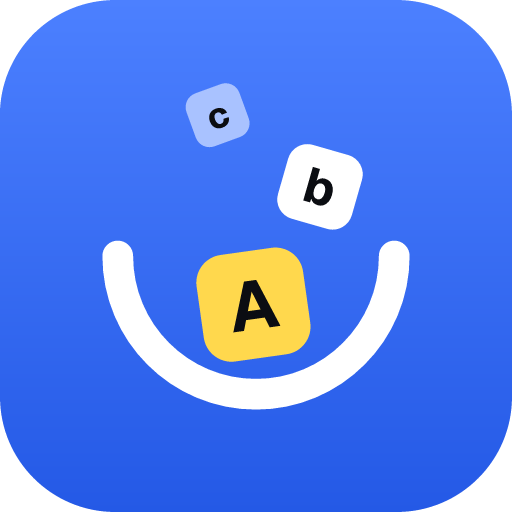

  

  # Chat English Labs

  **把说出口的英语，慢慢留成自己的成长记录。**

  *Make real conversations part of how we learn to speak.*

Chat English Labs 探索如何让英语口语练习发生在真实对话里。一个人可以和 Alex 聊，也可以和朋友一起说；AI 在合适的时候接话、帮助回看表达，让练习不止于当下的一句回答。

We build tools for learning spoken English through real conversations. Our goal is to help people speak, reflect, and keep improving at their own pace.

### 正在做什么 · What we're building

- **Live 对话**：支持独自练习和多人同场对话，让 Alex 在合适的时候参与。
- **即时反馈**：结合完整表达与上下文给出纠正，尽量不把犹豫或停顿误当成语言错误。
- **会话回看**：保留录音、对话与反馈，方便日后重新听、重新练。

我们正在准备开源 Live 的相关能力。代码、许可和参与方式将在发布时说明。

We are preparing to open source parts of Live. The code, license, and contribution guide will be published with the release.

[体验 Chat English](https://chatenglish.cc) · [阅读技术手记](https://chatenglish.cc/docs/)
